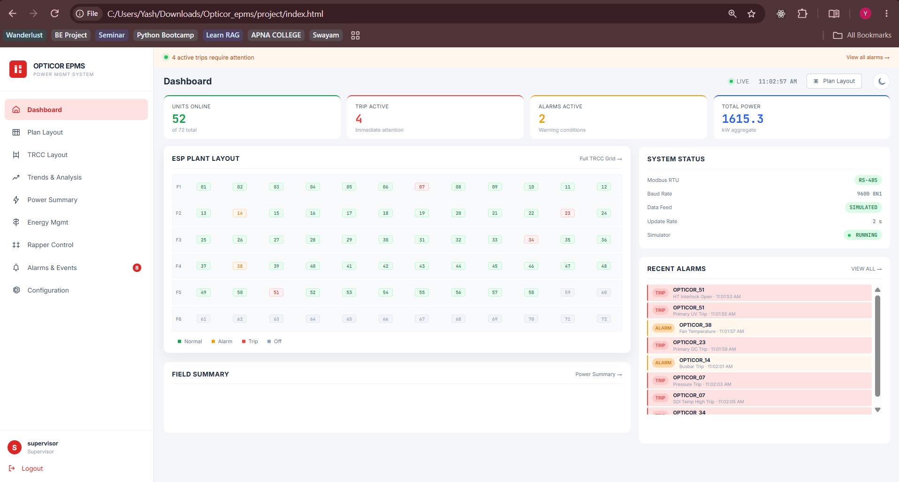
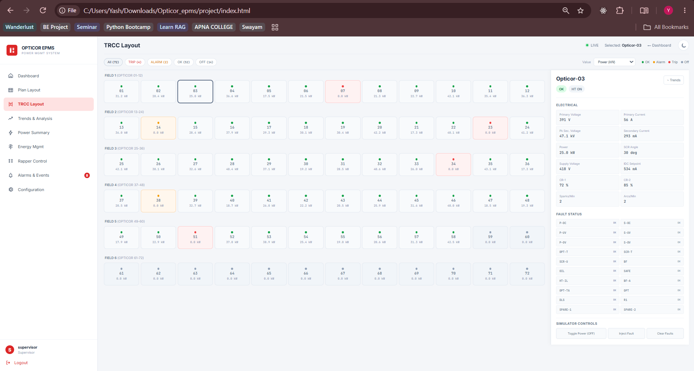
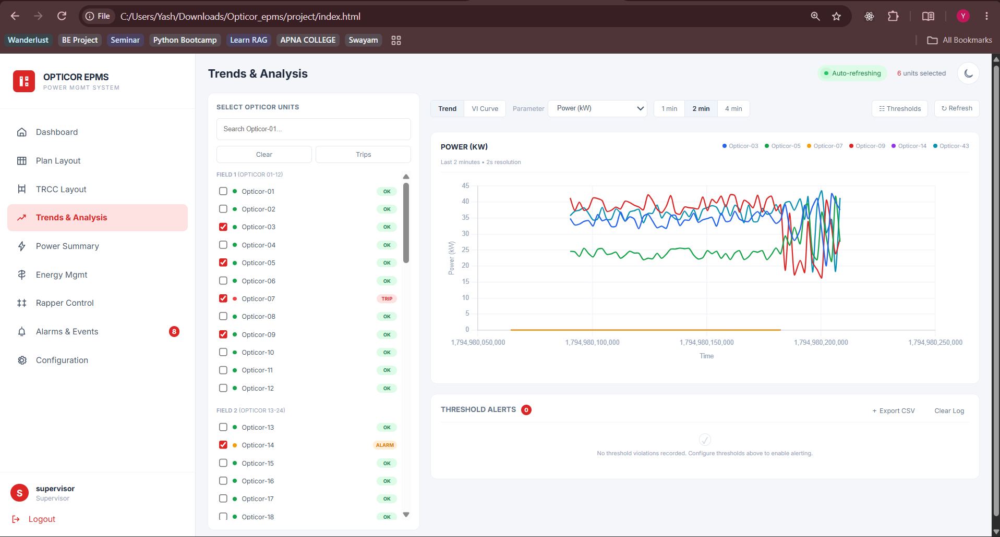
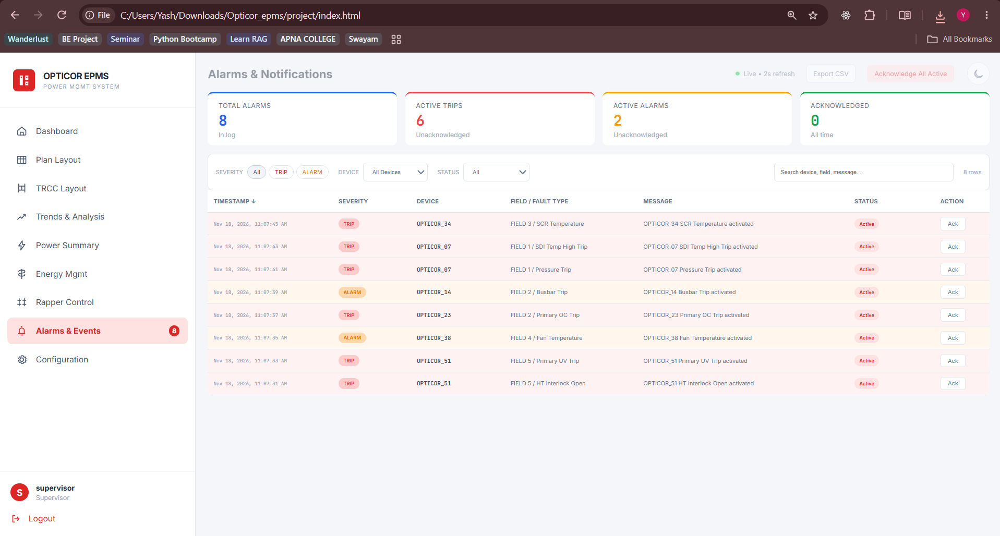
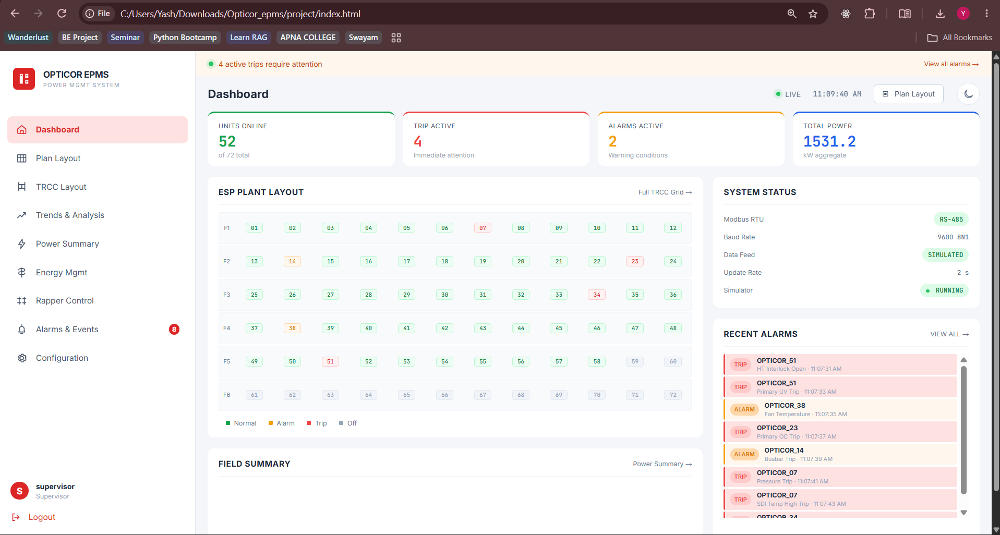
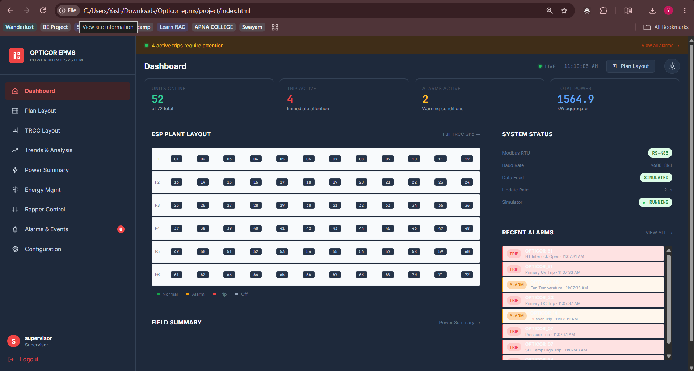
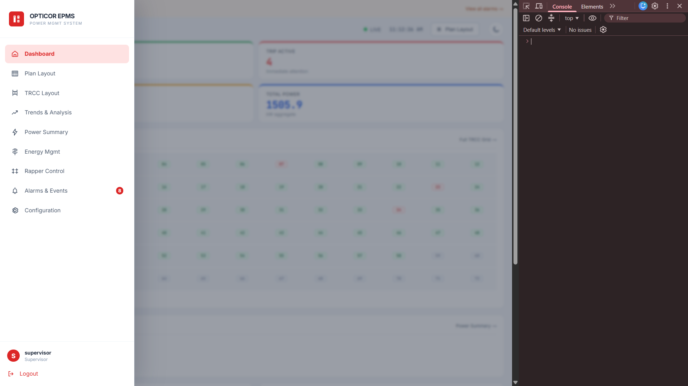

# Opticor EPMS

Opticor EPMS is a browser-based power management system dashboard for monitoring and controlling a simulated fleet of 72 Opticor units. The interface presents plant status, field layouts, live electrical telemetry, trend analysis, alarms, threshold violations, and basic operator session controls.

The repository is a static HTML/CSS/JavaScript application. It does not require a framework, package installation, compilation step, or module bundler. It can open directly with `file://` or be served by Live Server or a basic local HTTP server.

## Key Features

### Application Shell

- Fixed 240px navigation sidebar with inline SVG icons.
- Sidebar links for Dashboard, Plan Layout, TRCC Layout, Trends & Analysis, Power Summary, Energy Mgmt, Rapper Control, Alarms & Events, and Configuration.
- Live unacknowledged alarm count synchronized with the central alarm state.
- Operator user details and a Logout action.
- Client-side view switching with no full page reload.
- Responsive slide-over sidebar below 1024px.
- Persistent light/dark theme preference.

### Dashboard

- Green or warning top status banner based on active TRIP units.
- Live clock and dashboard header controls.
- Four KPI cards:
  - Units Online
  - Trip Active
  - Alarms Active
  - Total Power
- ESP Plant Layout containing six field rows and 12 unit buttons per field.
- Status styling for OK, ALARM, TRIP, and OFF units.
- System Status for Modbus RTU, baud rate, data feed, update rate, and simulator status.
- Scrollable Recent Alarms list.
- Unit selection from the plant grid opens the matching TRCC view.

### TRCC Layout

- Live `ALL`, `TRIP`, `ALARM`, `OK`, and `OFF` filter pills.
- Metric selector for Power, Primary Voltage, and Secondary Current.
- Six field sections, each containing 12 unit tiles.
- 340px right inspector panel for the selected unit.
- Selected-unit status and HT status.
- 12 electrical parameter cards.
- 20 fault indicator pills.
- Simulator controls for:
  - Switching the selected unit ON/OFF.
  - Injecting a realistic fault.
  - Clearing active faults.
- Fault injection updates unit status, KPIs, the dashboard grid, and the alarm log.

### Trends & Analysis

- Searchable unit checklist grouped by six fields.
- Quick Clear and Trips selection actions.
- Six-unit default selection.
- Trend and VI Curve modes.
- Power, Primary Voltage, and Secondary Current parameters.
- 1-minute, 2-minute, and 4-minute range controls.
- Chart.js live dataset updates every 2 seconds.
- Custom color-coded unit legend.
- Dynamic Chart.js grid and tick colors for the active theme.
- Threshold configuration modal with enable/disable, maximum, and minimum limits.
- Live threshold violation rows and red violation counter.
- Clear Log action.
- Trend CSV browser download.

### Alarms & Notifications

- Four alarm KPI cards for total alarms, active trips, active alarms, and acknowledged alarms.
- Severity, device, status, and text filtering.
- Sortable alarm table columns.
- Unacknowledged TRIP and ALARM row tinting.
- Individual acknowledgement actions.
- Acknowledge All Active action.
- Filtered alarm CSV browser download.
- Live sidebar badge synchronization.

### Other Implemented UI

- Plan Layout, Power Summary, Energy Mgmt, Rapper Control, and Configuration use clean placeholder views.
- Operator Authentication modal opened from Logout.
- The authentication form pre-fills `supervisor` / `••••••` and provides Supervisor/Operator roles.
- Card hover elevation, view fade-in transitions, and pulsing LIVE indicators.

## How It Works

### Application Architecture

The application uses classic scripts rather than JavaScript modules:

1. `project/index.html` loads Chart.js from jsDelivr, then loads the CSS and JavaScript files in dependency order.
2. `project/js/store.js` creates `window.EpmsStore`.
3. View modules register `mount()` and `unmount()` APIs on `window`.
4. `project/js/app.js` handles sidebar routing and central UI concerns such as the badge, theme, authentication modal, and responsive drawer.
5. The active view renders HTML into `#workspace`; switching views calls the previous view's `unmount()` function before mounting the new one.

### State Management

`window.EpmsStore` is a centralized, pub/sub state manager:

- Generates 72 units in six fields of 12 units.
- Tracks unit status, HT status, 12 electrical metrics, 20 fault flags, and 60 history samples.
- Runs a two-second simulation interval for active units.
- Recalculates aggregate KPIs after simulation ticks and unit control actions.
- Maintains the alarm log and acknowledgement state.
- Deep-copies state for subscribers, so view modules receive snapshots rather than direct mutable state.
- Exposes unit filtering, alarm acknowledgement, simulation controls, power controls, fault injection, and fault clearing.

Every view subscribes only while mounted. This prevents inactive views from adding repeated chart or DOM update work.

### Styling

- `project/css/variables.css` defines reusable light-mode and `[data-theme="dark"]` design tokens.
- `project/css/styles.css` contains the sidebar, workspace, Grid/Flex layouts, view-specific cards, modals, responsive rules, and micro-interactions.
- The default desktop layout is intentionally light mode.
- Dark mode replaces workspace, card, border, sidebar, text, and control colors while preserving status colors.

### External Browser Resources

- Google Fonts: Inter and JetBrains Mono.
- Chart.js 4.4.4 from jsDelivr.
- No npm dependencies, CSS framework, JavaScript framework, build process, or ES module import is used.

## Project Structure

```text
opticor-epms/
├── project/
│   ├── index.html                 # Application shell, sidebar, modals, and script loading
│   ├── assets/                    # Optional screenshots and static visual assets
│   ├── css/
│   │   ├── variables.css          # Light/dark CSS custom properties
│   │   └── styles.css             # Global and view-specific layout/styling
│   └── js/
│       ├── app.js                 # View routing, header controls, theme, drawer, login modal
│       ├── store.js               # Central state, simulation, alarms, KPIs, and pub/sub
│       └── views/
│           ├── dashboard.js       # Dashboard KPIs, plant grid, system status, recent alarms
│           ├── trccLayout.js      # Field grids, inspector, fault and power controls
│           ├── trends.js          # Unit selection, Chart.js, thresholds, trend CSV export
│           └── alarms.js          # Alarm filtering, table, acknowledgement, alarm CSV export
├── ai-session/                    # Optional session notes/artifacts generated during development
├── README.md                      # Project documentation
└── .gitignore
```

> `project/assets/` and `ai-session/` are optional documentation locations; they are not required for the application to run. The application itself does not reference files in those directories.

## Getting Started

### Option 1: Open Directly

1. Clone or download this repository.
2. Open `project/index.html` in Chrome or Edge.
3. The app should initialize automatically from `file://`.

Direct file opening works because the application uses classic `<script>` tags rather than ES modules. A network connection is needed for Google Fonts and Chart.js CDN resources.

### Option 2: VS Code Live Server

1. Open the repository in VS Code.
2. Install the Live Server extension.
3. Right-click `project/index.html`.
4. Select **Open with Live Server**.
5. Use the URL shown by Live Server, normally `http://127.0.0.1:5500/project/index.html`.

### Option 3: Python HTTP Server

From the repository root:

```powershell
python -m http.server 5500
```

Open:

```text
http://localhost:5500/project/index.html
```

Any other static HTTP server can serve the same `project/` directory.

## Screenshots

Add captured images to `project/assets/` and replace these placeholders:

### Desktop Dashboard



### TRCC Layout



### Trends & Analysis



### Alarms & Notifications



### Light and Dark Themes





### Responsive Sidebar Drawer



## File-Specific Notes

- `index.html` contains the fixed shell and authentication markup.
- `variables.css` owns the theme and core design tokens.
- `styles.css` owns all layout and component styling.
- `app.js` owns routing, theme, authentication, unread badge, drawer, and header controls.
- `store.js` owns the simulation and shared state.
- Dashboard, TRCC, Trends, and Alarms are mounted/unmounted by dedicated view modules.
